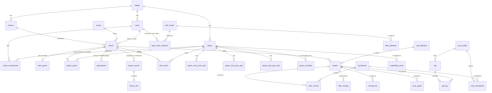

# PickPilot database structure

This document describes how the PickPilot database should be structured. **Nothing here is built yet.** The website in this folder runs on mock data in `src/data/`; this is the design the real backend should follow so the screens can switch to it without being rewritten.

It extends the outline in section 6 of `../../docs/Tech_Stack_and_Plan.md` with the tables the first NBA screens need: shot zone, shot type and play type splits, defense-versus-position rank snapshots, prop grades, the filter catalog, similar-player comparisons, and research slips with legs.

Contents:

1. [How to read this document](#1-how-to-read-this-document)
2. [Conventions](#2-conventions)
3. [Relationship diagram](#3-relationship-diagram)
4. [Tables](#4-tables)
5. [Which screen reads which table](#5-which-screen-reads-which-table)
6. [Stored or computed](#6-stored-or-computed)
7. [Build order: Phase 1 and later](#7-build-order-phase-1-and-later)
8. [How the mock data differs from this design](#8-how-the-mock-data-differs-from-this-design)
9. [Open decisions](#9-open-decisions)

---

## 1. How to read this document

- The database is **PostgreSQL** (Supabase), with the schema written in Drizzle, as the tech plan specifies. Types below are Postgres types.
- Each table lists its columns, keys and indexes. **PK** is the primary key, **FK** a foreign key, **UQ** a unique constraint.
- Each table has a **Phase** tag that says when it is first needed. The phases are the ones in section 9.3 of the tech plan (Phase 1 Foundation, Phase 2 Games, Phase 3 Players, Phase 4 Pilot, Phase 5 News).
- The TypeScript shapes the screens read are in `src/data/types.ts`. Section 5 maps each screen and each repository function to the tables behind it.

## 2. Conventions

### Naming

- Table and column names are `snake_case`, tables are singular (`player_game`, not `player_games`).
- Foreign keys are named `<table>_id`.
- Enumerations are Postgres `enum` types named `<meaning>_enum`, listed with each table. Catalog values that change with product decisions (stats, filters, rank metrics, sportsbooks) are lookup tables instead, so adding one is a row, not a migration.

### Identity

| Kind of row | Primary key | Why |
| --- | --- | --- |
| Sports data (teams, players, fixtures, markets, stats) | `bigint generated always as identity` | Compact, fast joins, high volume |
| Anything a user owns (profiles, slips, share links) | `uuid` (`gen_random_uuid()`) | Cannot be guessed or enumerated |
| Lookup catalogs (stat, filter, rank metric) | Short `text` code such as `PTS` or `dvp` | The code is also what the URL and the front-end use |

- Teams, players and fixtures also carry a `slug` for URLs (`bos`, `jayson-tatum`, `2026-11-13-nyk-bos`). Slugs are unique within a league and never reused. The numeric id is what other tables reference.
- **No provider id is ever stored on a domain table.** Every BallDontLie, Odds API or RotoWire id goes through `provider_entity_map`. This is what prevents one game's card from showing another game's markets.

### Time

- Instants are `timestamptz`, stored in UTC.
- A game's calendar day is a separate `date` column (`slate_date`) in the league's own time zone (Eastern for the NBA), so a 10:30 PM Pacific tip stays on the right slate.
- Every row written by the worker has `created_at` and `updated_at`. Tables that hold provider data also have `source_updated_at`, the provider's own timestamp, because the blueprint requires a "last updated" time on every source.

### Numbers

- American odds are `integer` (`-110`, `+164`). Decimal odds and implied probability are computed.
- Lines are `numeric(6,1)` (`28.5`, `-4.5`, `224.5`).
- Counting stats are `smallint`. Minutes are `numeric(4,1)`.
- Percentages are stored as the counts behind them wherever possible (`fgm`, `fga`) and computed on read. Where a percentage is itself the fact (usage rate), it is `numeric(5,2)` in percent.
- Ranks are `smallint`, 1 to the number of teams in the league.

### Missing data

- **Missing is `NULL`, never `0`.** A player who did not play has a `participation` row and no `player_game` row. A played game with zero points is a `player_game` row with `pts = 0`.
- A stat a provider does not supply is `NULL` and the screen shows "Unavailable".

### History

- Facts that change over time and that research depends on are **append-only**: price changes, availability events, lineup versions, rank snapshots. Rows are never updated in place; the newest row wins.
- Nothing is hard-deleted except user data on an account deletion request.

### Sport-specific stats

- `player_game` and `team_game` have typed columns for the stats every basketball screen uses, plus a `stats jsonb` column for the rest. The keys allowed in `stats` are defined per league in the `sports-config` package and validated when the worker writes.
- Other sports add their own typed columns later or live in `stats` until a screen needs to filter on them.

### Rank direction

One rule, applied everywhere, so a filter never has to know which way a metric points:

| Kind of metric | Rank 1 | Last rank |
| --- | --- | --- |
| Defense (what a team allows) | Toughest matchup for an opposing player | Softest matchup |
| Tempo (pace), when used as a matchup filter | Slowest | Fastest |
| Offense (what a team produces) | Best | Worst |

The front-end constant `SOFT_RANK_THRESHOLD` (20) and the "Tough / All / Soft" presets in `src/lib/research/matchup.ts` rely on this.

---

## 3. Relationship diagram

Only the main relationships are drawn. Lookup tables and user tables are listed in section 4.

---

## 4. Tables

### 4.1 Reference data

#### `league` · Phase 1

| Column | Type | Notes |
| --- | --- | --- |
| `id` | `smallint` PK | |
| `slug` | `text` UQ | `nba`. First URL segment. |
| `name` | `text` | `NBA` |
| `sport` | `sport_enum` | `basketball`, `baseball`, `football` |
| `team_count` | `smallint` | 30. Also the worst possible rank. |
| `timezone` | `text` | `America/New_York`. Defines `slate_date`. |
| `is_active` | `boolean` | Hidden from the league switcher when false. |
| `sort_order` | `smallint` | |

#### `season` · Phase 1

| Column | Type | Notes |
| --- | --- | --- |
| `id` | `smallint` PK | |
| `league_id` | `smallint` FK → `league` | |
| `label` | `text` | `2026-27` |
| `short_label` | `text` | `'26-'27`, used on window toggles |
| `starts_on`, `ends_on` | `date` | |
| `is_current` | `boolean` | One per league |

UQ (`league_id`, `label`).

#### `venue` · Phase 1

| Column | Type | Notes |
| --- | --- | --- |
| `id` | `integer` PK | |
| `name`, `city`, `region`, `country` | `text` | |
| `timezone` | `text` | |
| `roof` | `roof_enum` | `indoor`, `open`, `retractable`. Weather only applies to the last two. |
| `orientation_deg` | `smallint` NULL | Field orientation, for wind in baseball and football |
| `latitude`, `longitude` | `numeric(8,5)` NULL | For forecasts |

#### `team` · Phase 1

| Column | Type | Notes |
| --- | --- | --- |
| `id` | `integer` PK | |
| `league_id` | `smallint` FK → `league` | |
| `slug` | `text` | `bos` |
| `abbr` | `text` | `BOS` |
| `city`, `nickname`, `full_name` | `text` | `Boston`, `Celtics`, `Boston Celtics` |
| `conference`, `division` | `text` NULL | |
| `primary_color` | `text` | Hex. Used for ambient glows only. |
| `logo_key` | `text` NULL | Key into image storage. Never a URL. |
| `venue_id` | `integer` FK → `venue` NULL | Home arena |
| `is_active` | `boolean` | |

UQ (`league_id`, `slug`), UQ (`league_id`, `abbr`).

#### `player` · Phase 1

| Column | Type | Notes |
| --- | --- | --- |
| `id` | `bigint` PK | |
| `league_id` | `smallint` FK → `league` | |
| `slug` | `text` | `jayson-tatum`. A second player with the same name gets a suffix. |
| `first_name`, `last_name`, `full_name` | `text` | |
| `suffix` | `text` NULL | `Jr.`, `II` |
| `position` | `text` | Listed position: `PG`, `SG`, `SF`, `PF`, `C`, `G`, `F` |
| `matchup_position` | `text` | One of the five positions that defense-versus-position ranks exist for |
| `position_group` | `text` | `guards`, `wings`, `bigs`. Used for similar-player comparisons. |
| `height_cm`, `weight_kg` | `smallint` NULL | |
| `birth_date` | `date` NULL | |
| `headshot_key` | `text` NULL | Key into image storage |
| `current_team_id` | `integer` FK → `team` NULL | Copy of the open `roster_membership`, for quick reads |
| `is_active` | `boolean` | |

UQ (`league_id`, `slug`). Index on `current_team_id`. Trigram index on `full_name` for search.

#### `roster_membership` · Phase 1

Who was on which team and when. Needed because players are traded and a past game must show the team they played for that night.

| Column | Type | Notes |
| --- | --- | --- |
| `id` | `bigint` PK | |
| `player_id` | `bigint` FK → `player` | |
| `team_id` | `integer` FK → `team` | |
| `season_id` | `smallint` FK → `season` | |
| `starts_on` | `date` | |
| `ends_on` | `date` NULL | NULL while current |
| `jersey_number` | `text` NULL | |
| `depth_role` | `text` | `starter`, `bench`. The usual role; tonight's lineup comes from `lineup_version`. |
| `depth_order` | `smallint` | Order within the role |

Index (`team_id`, `ends_on`), index (`player_id`, `starts_on`).

#### `sportsbook` · Phase 1

| Column | Type | Notes |
| --- | --- | --- |
| `id` | `smallint` PK | |
| `code` | `text` UQ | `FD`, `DK`, `MGM`, `CZR`, `PIN`. Shown next to prices. |
| `name` | `text` | `FanDuel` |
| `logo_key` | `text` NULL | |
| `deep_link_template` | `text` NULL | |
| `is_default` | `boolean` | In the default selection for a new visitor |
| `is_active` | `boolean` | |
| `sort_order` | `smallint` | |

#### `provider` and `provider_entity_map` · Phase 1

`provider`: `id smallint` PK, `code text` UQ (`balldontlie`, `the_odds_api`, `rotowire`, `x`, `nws`), `name`.

`provider_entity_map`:

| Column | Type | Notes |
| --- | --- | --- |
| `provider_id` | `smallint` FK → `provider` | |
| `entity_type` | `entity_type_enum` | `league`, `team`, `player`, `fixture`, `venue`, `sportsbook`, `market` |
| `provider_key` | `text` | The provider's id, as text |
| `entity_id` | `bigint` | Our id in the table named by `entity_type` |
| `confidence` | `text` | `exact`, `matched_by_name`, `manual` |
| `created_at` | `timestamptz` | |

PK (`provider_id`, `entity_type`, `provider_key`). Index (`entity_type`, `entity_id`).

#### `stat_definition` · Phase 1

The stats a prop can be posted on, per league. Mirrors `STAT_FAMILIES` in `src/lib/research/stats.ts`.

| Column | Type | Notes |
| --- | --- | --- |
| `league_id` | `smallint` FK → `league` | |
| `code` | `text` | `PTS`, `AST`, `REB`, `3PM`, `PA`, `PR`, `RA`, `PRA`, `DD` |
| `label` | `text` | `Points`, `Pts+Reb+Ast` |
| `short_label` | `text` | `PTS`, `P+R+A` |
| `kind` | `text` | `counting`, `combo`, `yes_no` |
| `components` | `text[]` | Columns of `player_game` that are summed: `{pts,reb,ast}`. Empty for `yes_no`. |
| `sort_order` | `smallint` | Order of the stat tabs |
| `is_active` | `boolean` | |

PK (`league_id`, `code`).

---

### 4.2 Schedule and results

#### `fixture` · Phase 1

One game. Called "game" on screen and `Game` in the front-end types.

| Column | Type | Notes |
| --- | --- | --- |
| `id` | `bigint` PK | |
| `league_id` | `smallint` FK → `league` | |
| `season_id` | `smallint` FK → `season` | |
| `slug` | `text` | `2026-11-13-nyk-bos` (date, away, home; `-g2` for a doubleheader) |
| `season_phase` | `season_phase_enum` | `preseason`, `regular`, `play_in`, `playoffs` |
| `slate_date` | `date` | Calendar day in the league's time zone |
| `starts_at` | `timestamptz` | |
| `status` | `fixture_status_enum` | `scheduled`, `live`, `final`, `postponed`, `cancelled` |
| `away_team_id`, `home_team_id` | `integer` FK → `team` | |
| `venue_id` | `integer` FK → `venue` | |
| `is_neutral_site` | `boolean` | |
| `doubleheader_no` | `smallint` NULL | Baseball |
| `network` | `text` NULL | `TNT` |
| `away_score`, `home_score` | `smallint` NULL | NULL until the game starts |
| `period` | `smallint` NULL | Current or last period |
| `source_updated_at` | `timestamptz` | |

UQ (`league_id`, `slug`). Index (`league_id`, `slate_date`), the slate query. Index (`home_team_id`, `starts_at`), index (`away_team_id`, `starts_at`).

#### `team_game` · Phase 1

One row per team per finished game. Two rows per fixture.

| Column | Type | Notes |
| --- | --- | --- |
| `fixture_id` | `bigint` FK → `fixture` | |
| `team_id` | `integer` FK → `team` | |
| `opponent_team_id` | `integer` FK → `team` | |
| `game_date` | `date` | Copy of `fixture.slate_date`, for ordering without a join |
| `is_home` | `boolean` | |
| `rest_days` | `smallint` | Full days off before the game. 0 is the second night of a back-to-back. |
| `won` | `boolean` | |
| `pts`, `pts_allowed` | `smallint` | |
| `pts_h1`, `pts_q1`, `opp_pts_h1`, `opp_pts_q1` | `smallint` NULL | For first-half and first-quarter trends |
| `fgm`, `fga`, `fg3m`, `fg3a`, `ftm`, `fta` | `smallint` | |
| `oreb`, `dreb`, `ast`, `tov`, `stl`, `blk`, `pf` | `smallint` | |
| `paint_pts`, `fastbreak_pts` | `smallint` NULL | |
| `possessions` | `numeric(5,1)` NULL | |
| `close_spread` | `numeric(6,1)` NULL | This team's closing spread (`-4.5`) |
| `close_total` | `numeric(6,1)` NULL | |
| `close_h1_spread`, `close_q1_total` | `numeric(6,1)` NULL | |
| `ats_result`, `h1_ats_result` | `graded_enum` NULL | `win`, `loss`, `push` |
| `ou_result`, `q1_ou_result` | `ou_enum` NULL | `over`, `under`, `push` |
| `stats` | `jsonb` | Anything else the provider sends |

PK (`fixture_id`, `team_id`). Index (`team_id`, `game_date desc`).

The trend records on the Game lines page ("8-3 ATS", "9-3 1H ATS") are counts over these result columns. Pushes are left out of both sides.

#### `player_game` · Phase 1

One row per player per game **in which he played**. This is the table every chart and filter is built on.

| Column | Type | Notes |
| --- | --- | --- |
| `fixture_id` | `bigint` FK → `fixture` | |
| `player_id` | `bigint` FK → `player` | |
| `team_id`, `opponent_team_id` | `integer` FK → `team` | The team he played for that night |
| `game_date` | `date` | |
| `is_home` | `boolean` | |
| `started` | `boolean` | |
| `rest_days` | `smallint` | Copied from his team's `team_game` row |
| `min` | `numeric(4,1)` | |
| `pts`, `reb`, `oreb`, `dreb`, `ast`, `stl`, `blk`, `tov`, `pf` | `smallint` | |
| `fgm`, `fga`, `fg3m`, `fg3a`, `ftm`, `fta` | `smallint` | `fg3m` is the "3PM" stat |
| `plus_minus` | `smallint` NULL | |
| `usg_pct` | `numeric(5,2)` NULL | Usage rate |
| `stats` | `jsonb` | Other stats, validated by `sports-config` |

PK (`fixture_id`, `player_id`). Index (`player_id`, `game_date desc`), the game-log query. Index (`team_id`, `fixture_id`).

Combination stats (Pts+Ast, Pts+Reb+Ast) and double-doubles are **not** stored. They are computed from these columns by `getStatValue` in `src/lib/research/stats.ts`.

#### `participation` · Phase 1

One row per rostered player per game, whether he played or not. This is what makes "with or without a teammate" filters possible and keeps a missed game from being read as a zero.

| Column | Type | Notes |
| --- | --- | --- |
| `fixture_id` | `bigint` FK → `fixture` | |
| `player_id` | `bigint` FK → `player` | |
| `team_id` | `integer` FK → `team` | |
| `status` | `participation_enum` | `played`, `dnp_coach`, `inactive_injury`, `inactive_rest`, `not_with_team`, `suspended` |
| `reason` | `text` NULL | "Left ankle surgery" |
| `availability_event_id` | `bigint` FK → `availability_event` NULL | The report that explained the absence |

PK (`fixture_id`, `player_id`). Index (`team_id`, `fixture_id`), index (`player_id`, `status`).

The front-end field `PlayerGameLogEntry.teammatesOut` is the list of teammates whose row for that fixture is not `played`.

#### `lineup_version` and `lineup_slot` · Phase 2

Expected and confirmed starting lineups. Each change is a new version.

`lineup_version`:

| Column | Type | Notes |
| --- | --- | --- |
| `id` | `bigint` PK | |
| `fixture_id` | `bigint` FK → `fixture` | |
| `team_id` | `integer` FK → `team` | |
| `version` | `smallint` | Counts up from 1 per fixture and team |
| `status` | `lineup_status_enum` | `projected`, `confirmed` |
| `provider_id` | `smallint` FK → `provider` | |
| `reported_at` | `timestamptz` | |
| `is_current` | `boolean` | True on the newest version only |

UQ (`fixture_id`, `team_id`, `version`). Partial unique index on (`fixture_id`, `team_id`) where `is_current`.

`lineup_slot`: `lineup_version_id` FK, `slot smallint` (1 to 5), `position text`, `player_id` FK. PK (`lineup_version_id`, `slot`).

---

### 4.3 Ranks and splits

#### `rank_metric` · Phase 1

The catalog of everything teams are ranked on.

| Column | Type | Notes |
| --- | --- | --- |
| `code` | `text` PK | See the list below |
| `league_id` | `smallint` FK → `league` | |
| `label` | `text` | "Def vs PnR Ball Handler" |
| `side` | `text` | `defense`, `offense`, `tempo`. Sets the rank direction (section 2). |
| `dimension` | `text` | `team`, `position`, `zone`, `shot_type`, `play_type` |
| `by_position` | `boolean` | True for defense-versus-position: one rank per position |
| `source` | `text` | `box_score`, `shot_events`, `tracking`. `tracking` needs a licensed feed. |
| `unit` | `text` | `per_game`, `per_100`, `pct`, `ppp` |

Metrics the first screens need, with the name the front-end uses (`OppRankMetric` in `src/data/types.ts`):

| Code | Front-end key | Source |
| --- | --- | --- |
| `def_vs_pos_pts` | `dvp` (per position) | box score |
| `def_rating` | `defRtg` | box score |
| `pace` | `pace` | box score |
| `def_ft_rate` | `ftRate` | box score |
| `def_reb_allowed` | `rebAllowed` | box score |
| `def_paint_pts` | `paintPts` | box score |
| `def_zone_atb3`, `def_zone_rim`, `def_zone_mid`, `def_zone_paint`, `def_zone_lc3`, `def_zone_rc3`, `def_zone_corner3` | `zoneAtb3`, `zoneRim`, `corner3`, and the shot-zone module | shot events |
| `def_pull_up`, `def_catch_shoot` | `pullUp`, `catchShoot` | shot events, if the feed labels shot type; otherwise tracking |
| `def_pnr_handler`, `def_iso`, `def_transition`, `def_spot_up`, `def_post_up` | `pnr`, `iso`, `transition`, and the play-type module | tracking |
| `off_rating`, `off_pts`, `off_fg_pct`, `off_fg3_pct`, `off_fg3m`, `off_reb`, `off_ast`, `off_tov` | radar and stat bars | box score |
| `def_pts`, `def_fg_pct`, `def_fg3_pct`, `def_ast`, `def_tov_forced` | stat bars | box score |

#### `team_rank_snapshot` · Phase 1

Every team's value and rank on every metric, **as it stood on each date**. A filter on a game played on October 28 must use the opponent's rank on October 28, not today's.

| Column | Type | Notes |
| --- | --- | --- |
| `season_id` | `smallint` FK → `season` | |
| `as_of_date` | `date` | Ranks after all games up to and including this date |
| `window` | `stat_window_enum` | `season`, `l3`, `l5`, `l10` |
| `team_id` | `integer` FK → `team` | |
| `metric_code` | `text` FK → `rank_metric` | |
| `position` | `text` | `PG` to `C` for by-position metrics, `ALL` otherwise |
| `value` | `numeric(8,3)` | The number being ranked |
| `rank` | `smallint` | 1 to `league.team_count`. Ties share the better rank. |
| `games` | `smallint` | Games behind the value |

PK (`season_id`, `as_of_date`, `window`, `team_id`, `metric_code`, `position`). Index (`team_id`, `metric_code`, `position`, `as_of_date desc`). Partition by `season_id`.

Size: about 30 teams × 45 metric rows × 4 windows × 170 dates, roughly one million rows a season. Only dates on which at least one game was played get a snapshot.

Read by: the rank badges in the filter drawer, the trend line on the hit-rate chart, the opponent rank on each shot zone, shot type and play type, the radar chart and the stat bars.

#### `shot_event` · Phase 3

One row per field-goal attempt, from play-by-play.

| Column | Type | Notes |
| --- | --- | --- |
| `id` | `bigint` PK | |
| `fixture_id` | `bigint` FK → `fixture` | |
| `player_id` | `bigint` FK → `player` | |
| `team_id`, `opponent_team_id` | `integer` FK → `team` | |
| `period` | `smallint` | |
| `clock_seconds` | `smallint` | Seconds left in the period |
| `x`, `y` | `numeric(5,1)` | Court coordinates in feet from the basket |
| `distance_ft` | `numeric(4,1)` | |
| `zone` | `shot_zone_enum` | `atb3`, `rim`, `mid`, `lc3`, `rc3`, `paint`: the six zones on the court map |
| `shot_type` | `shot_type_enum` NULL | `pull_up`, `catch_shoot`, `rim`, `other`. NULL when the feed does not say. |
| `is_three` | `boolean` | |
| `made` | `boolean` | |
| `assist_player_id` | `bigint` FK → `player` NULL | |

Index (`player_id`, `fixture_id`). Index (`opponent_team_id`, `zone`, `fixture_id`). Partition by season.

#### `player_shot_zone_split` · Phase 3

A player's shots by zone, rebuilt from `shot_event` after each of his games.

| Column | Type | Notes |
| --- | --- | --- |
| `player_id` | `bigint` FK → `player` | |
| `season_id` | `smallint` FK → `season` | |
| `scope` | `text` | `season`, `l5`, `l10` |
| `zone` | `shot_zone_enum` | |
| `fga`, `fgm` | `smallint` | |
| `share_pct` | `numeric(5,2)` | Share of his attempts. A scope sums to 100. |
| `through_fixture_id` | `bigint` FK → `fixture` | Last game included. Also the bundle version. |

PK (`player_id`, `season_id`, `scope`, `zone`).

#### `player_shot_type_split` · Phase 3

Same shape for shot types.

| Column | Type | Notes |
| --- | --- | --- |
| `player_id`, `season_id`, `scope` | as above | |
| `shot_type` | `shot_type_enum` | |
| `fga`, `fgm`, `fg3m` | `smallint` | |
| `pts` | `smallint` | Points scored on these shots |
| `games` | `smallint` | To turn `pts` into points per game |
| `share_pct` | `numeric(5,2)` | |
| `through_fixture_id` | `bigint` | |

PK (`player_id`, `season_id`, `scope`, `shot_type`). Effective field-goal percentage is computed from `fgm`, `fg3m` and `fga`.

#### `player_play_type_split` · Later (needs a licensed tracking feed)

| Column | Type | Notes |
| --- | --- | --- |
| `player_id`, `season_id`, `scope` | as above | |
| `play_type` | `play_type_enum` | `pnr_handler`, `iso`, `transition`, `spot_up`, `post_up` |
| `possessions` | `smallint` | |
| `pts` | `smallint` | |
| `games` | `smallint` | |
| `share_pct` | `numeric(5,2)` | |
| `provider_id` | `smallint` FK → `provider` | Play types are a vendor's judgment, so the source is recorded |
| `through_fixture_id` | `bigint` | |

PK (`player_id`, `season_id`, `scope`, `play_type`). Points per possession is computed.

Play-type data is not in BallDontLie. Until a tracking provider is licensed this table stays empty and the module shows "Unavailable". The module is titled "Play Types"; the name "Synergy" from the prototype is a vendor's brand and should only appear if that vendor is the licensed source.

#### `team_standing` · Phase 1

The current record per team, kept by the worker so the slate does not count games on every request.

| Column | Type | Notes |
| --- | --- | --- |
| `team_id` | `integer` FK → `team` | |
| `season_id` | `smallint` FK → `season` | |
| `wins`, `losses` | `smallint` | |
| `home_wins`, `home_losses`, `away_wins`, `away_losses` | `smallint` | |
| `streak` | `smallint` | Positive for wins, negative for losses |
| `through_fixture_id` | `bigint` | |

PK (`team_id`, `season_id`).

---

### 4.4 Markets and prices

#### `market` · Phase 1

One thing that can be bet on in one game: Boston's spread, the game total, Jayson Tatum's points. The line is **not** on this table, because each book posts its own line and alternates.

| Column | Type | Notes |
| --- | --- | --- |
| `id` | `bigint` PK | |
| `fixture_id` | `bigint` FK → `fixture` | |
| `market_type` | `market_type_enum` | `spread`, `total`, `moneyline`, `player_prop`, `team_total` |
| `period` | `period_enum` | `game`, `h1`, `h2`, `q1`, `q2`, `q3`, `q4` |
| `team_id` | `integer` FK → `team` NULL | For team markets |
| `player_id` | `bigint` FK → `player` NULL | For player props |
| `stat_code` | `text` NULL | FK → `stat_definition`. For player props. |
| `is_featured` | `boolean` | The prop shown beside the player in lineups and rotation tables. Set by the worker: points if posted, otherwise the player's most-bet market. |
| `settlement_basis` | `text` NULL | Book rule that affects grading, such as "overtime included" |
| `created_at` | `timestamptz` | |

UQ (`fixture_id`, `market_type`, `period`, `team_id`, `player_id`, `stat_code`) with NULLs treated as equal. Index (`fixture_id`), index (`player_id`, `fixture_id`).

#### `offer_current` · Phase 1

The live price board: one row per market, book, side and line. Redis holds the hot copy the API serves; this table is its durable mirror.

| Column | Type | Notes |
| --- | --- | --- |
| `market_id` | `bigint` FK → `market` | |
| `sportsbook_id` | `smallint` FK → `sportsbook` | |
| `side` | `side_enum` | `over`, `under`, `home`, `away`, `yes`, `no` |
| `line` | `numeric(6,1)` | 0 for moneylines and yes/no markets |
| `price_american` | `integer` | |
| `is_primary` | `boolean` | The book's main line, as opposed to an alternate |
| `is_suspended` | `boolean` | |
| `deep_link` | `text` NULL | |
| `quoted_at` | `timestamptz` | The provider's timestamp |

PK (`market_id`, `sportsbook_id`, `side`, `line`). Index (`market_id`).

#### `offer_change` · Phase 1

Price history. A row is written only when a price or line changes.

| Column | Type | Notes |
| --- | --- | --- |
| `id` | `bigint` PK | |
| `market_id`, `sportsbook_id`, `side`, `line`, `price_american` | as above | The new values |
| `changed_at` | `timestamptz` | |

Partition by month on `changed_at`. Index (`market_id`, `changed_at`). Append-only. BallDontLie keeps no prop history, so this archive is the only record of past lines.

#### `closing_line` · Phase 1

The last primary line and price before the game started, per book, plus one consensus row.

| Column | Type | Notes |
| --- | --- | --- |
| `market_id` | `bigint` FK → `market` | |
| `sportsbook_id` | `smallint` FK → `sportsbook` NULL | NULL is the consensus row |
| `side` | `side_enum` | |
| `line` | `numeric(6,1)` | |
| `price_american` | `integer` | |
| `captured_at` | `timestamptz` | |

UQ (`market_id`, `sportsbook_id`, `side`).

Read by: `team_game` grading (against the spread, over/under), historical game lines, and the Similar Players module, which needs the line each comparable player faced on the night.

#### `prop_grade` · Phase 3

The letter grade next to a prop. The front-end never calculates a grade; it only colours the one it receives (`src/lib/research/grades.ts`).

| Column | Type | Notes |
| --- | --- | --- |
| `market_id` | `bigint` FK → `market` | |
| `side` | `side_enum` | |
| `line` | `numeric(6,1)` | The line the grade was computed for |
| `grade` | `grade_enum` | `A`, `A-`, `B+`, `B`, `C`, `D+`, `D`, `F` |
| `score` | `numeric(5,2)` | The number behind the letter, 0 to 100 |
| `inputs` | `jsonb` | What went in: hit rates by sample, opponent ranks, minutes outlook |
| `model_version` | `text` | The written formula's version |
| `computed_at` | `timestamptz` | |

PK (`market_id`, `side`, `line`, `model_version`). The formula has to be written down and published before this table is filled; the blueprint does not allow an unexplained rating.

---

### 4.5 Research catalogs and comparisons

#### `filter_definition` · Phase 3

The 22 matchup filters. Mirrors `FILTER_DEFS` in `src/lib/research/filters.ts`. Keeping them in a table lets a filter be switched off, reordered or limited to paid plans without a release.

| Column | Type | Notes |
| --- | --- | --- |
| `code` | `text` PK | `dvp`, `pnr`, `min_34`, `home_split`, … The same code appears in the page URL (`?filters=dvp:18-30`). |
| `league_id` | `smallint` FK → `league` | |
| `category` | `text` | `opp`, `zones`, `workload`, `splits`: the tabs in the drawer |
| `group_label` | `text` | "Opponent Matchup Ranks" |
| `rule_kind` | `text` | `opp_rank`, `min_stat`, `head_to_head`, `home`, `away`, `without_teammate`, `rested` |
| `rank_metric_code` | `text` FK → `rank_metric` NULL | For `opp_rank` rules |
| `stat_field` | `text` NULL | For `min_stat` rules: `min`, `fga`, `usg_pct` |
| `threshold` | `numeric(6,1)` NULL | For `min_stat` rules: 34, 20, 30 |
| `default_min`, `default_max` | `smallint` NULL | Rank window applied when the filter is first switched on |
| `name_template` | `text` | "Def vs Position ({position})" |
| `short_name_template` | `text` | "Def vs {position}" |
| `description_template` | `text` | |
| `min_tier` | `text` | `free`, `paid` |
| `sort_order` | `smallint` | |
| `is_active` | `boolean` | |

The rule itself (how a game is tested) stays in code in `research-engine`, keyed by `rule_kind`. The table holds what is configurable.

#### `player_similarity` · Phase 3

Which players are comparable to which, for the Similar Players module.

| Column | Type | Notes |
| --- | --- | --- |
| `player_id` | `bigint` FK → `player` | |
| `similar_player_id` | `bigint` FK → `player` | |
| `season_id` | `smallint` FK → `season` | |
| `score` | `numeric(5,4)` | 0 to 1 |
| `basis` | `jsonb` | What matched: position group, usage band, shot profile distance |
| `model_version` | `text` | |
| `computed_at` | `timestamptz` | |

PK (`player_id`, `similar_player_id`, `season_id`, `model_version`). Index (`player_id`, `score desc`).

The rows the module shows (date, comparable player, his line, his result) are **not** stored. They are a join: this player's comparables → their `player_game` rows against tonight's opponent → the `closing_line` for the same stat that night.

---

### 4.6 News

#### `availability_event` · Phase 2 for injuries on the game pages, Phase 5 for the News tab

Every injury and availability report, append-only.

| Column | Type | Notes |
| --- | --- | --- |
| `id` | `bigint` PK | |
| `league_id` | `smallint` FK → `league` | |
| `player_id` | `bigint` FK → `player` | |
| `team_id` | `integer` FK → `team` | |
| `fixture_id` | `bigint` FK → `fixture` NULL | The game the report is about, when it names one |
| `status` | `availability_enum` | `out`, `doubtful`, `questionable`, `probable`, `available` |
| `injury` | `text` NULL | "Left ankle surgery" |
| `note` | `text` NULL | The report's text |
| `impact_note` | `text` NULL | Who benefits, only when a source says so. Never written by the front-end. |
| `confidence` | `text` | `reported`, `confirmed` |
| `provider_id` | `smallint` FK → `provider` | |
| `source_url` | `text` NULL | |
| `supersedes_event_id` | `bigint` FK → `availability_event` NULL | For corrections |
| `reported_at` | `timestamptz` | |
| `created_at` | `timestamptz` | |

Index (`player_id`, `reported_at desc`), index (`fixture_id`), index (`league_id`, `reported_at desc`).

#### `player_availability_current` · Phase 2

The newest status per player, kept by the worker so pages do not scan the event history. `player_id` PK, `status`, `availability_event_id`, `fixture_id`, `updated_at`.

#### `weather_forecast` · Later

Outdoor sports only. Not needed for the NBA.

---

### 4.7 Users and slips

User tables hold personal data and are protected by row-level security: a user can read and write only their own rows.

#### `user_profile` · Phase 1

`id uuid` PK (the Supabase Auth user id), `display_name text` NULL, `created_at`, `deleted_at` NULL.

#### `user_preferences` · Phase 1

`user_id uuid` PK FK → `user_profile`, `timezone text`, `default_league_id smallint` FK, `odds_format text` (`american`, `decimal`), `updated_at`.

#### `user_sportsbook` · Phase 1

The books a user wants prices from. "Best price" is the best among these.

`user_id uuid` FK, `sportsbook_id smallint` FK, `sort_order smallint`. PK (`user_id`, `sportsbook_id`).

#### `entitlement` · Phase 4

`id bigint` PK, `user_id uuid` FK, `tier text` (`free`, `paid`), `source text` (`stripe`, `apple`, `promo`), `status text` (`active`, `past_due`, `cancelled`), `period_start`, `period_end timestamptz`, `external_ref text`. Index (`user_id`, `status`).

#### `slip` · Later (cross-device sync)

A research slip. At launch the slip lives only in the visitor's browser (see `src/features/slip/slipStore.ts`); the tech plan lists cross-device sync and named slips as later scope. These two tables are what that feature will use.

| Column | Type | Notes |
| --- | --- | --- |
| `id` | `uuid` PK | |
| `user_id` | `uuid` FK → `user_profile` | |
| `name` | `text` NULL | NULL for the default slip |
| `is_default` | `boolean` | One per user |
| `created_at`, `updated_at` | `timestamptz` | |

Index (`user_id`).

#### `slip_leg` · Later

One saved pick.

| Column | Type | Notes |
| --- | --- | --- |
| `id` | `uuid` PK | |
| `slip_id` | `uuid` FK → `slip`, cascade on delete | |
| `position` | `smallint` | Order on the slip |
| `market_id` | `bigint` FK → `market` | |
| `side` | `side_enum` | |
| `line` | `numeric(6,1)` | The exact line saved. It does not follow the market if the line moves. |
| `price_american` | `integer` | Price when saved |
| `sportsbook_id` | `smallint` FK → `sportsbook` NULL | Book that offered it |
| `research_state` | `jsonb` | Sample window, filters and threshold the user was looking at, so reopening restores them |
| `added_at` | `timestamptz` | |

UQ (`slip_id`, `market_id`, `side`, `line`): the same pick added from two screens is one leg. The front-end leg id (`prop:jayson-tatum:PTS:over:28.5`) encodes the same four things.

Titles, hit rates and current prices are not stored on the leg. They are computed when the slip is shown, with the saved price beside the current one.

#### `share_snapshot` · Phase 2

A read-only copy of a slip behind a short link.

| Column | Type | Notes |
| --- | --- | --- |
| `id` | `uuid` PK | |
| `short_code` | `text` UQ | In the share URL |
| `user_id` | `uuid` FK → `user_profile` NULL | NULL when shared by a visitor who is not signed in |
| `payload` | `jsonb` | The legs exactly as they were: titles, lines, prices, books, hit rates and their timestamp |
| `created_at` | `timestamptz` | |
| `expires_at` | `timestamptz` NULL | |

Never updated after it is written.

---

### 4.8 AI and Pilot · Phase 4

Listed for completeness; none of the screens in this project read them yet. See section 6 of the tech plan.

- `projection`: `player_id`, `fixture_id`, `stat_code`, `value`, `provider_id`, `model_version`, `computed_at`.
- `ai_overview`: `fixture_id`, `body`, `sources jsonb`, `data_as_of`, `model`, `generated_at`, `is_current`.
- `conversation`, `message`: Ask Pilot history.
- `usage_counter`: `user_id`, `day`, `kind`, `count`. Redis is the live counter; this is the record.

---

## 5. Which screen reads which table

### By screen

| Screen | Route | Tables |
| --- | --- | --- |
| Games board | `/nba/games` | `fixture`, `team`, `team_standing`, `market`, `offer_current`, `sportsbook`, `user_sportsbook` |
| Game header (all four game tabs) | `/nba/games/[gameId]/…` | `fixture`, `team`, `team_standing`, `venue`, `market`, `offer_current` |
| Matchup: starting lineups | `…/matchup` | `lineup_version`, `lineup_slot`, `player`, `player_game` (averages), `market`, `offer_current`, `prop_grade`, `player_availability_current` |
| Matchup: team comparison (radar, stat bars) | `…/matchup` | `team_rank_snapshot` for today's date and the chosen window |
| Players: rotation tables | `…/players` | `roster_membership`, `lineup_slot`, `player_game`, `market`, `offer_current`, `prop_grade`, `player_availability_current` |
| Game lines | `…/lines` | `market`, `offer_current`, `team_game` (trend records) |
| Injuries | `…/injuries` | `player_availability_current`, `availability_event`, `player` |
| Player props index | `/nba/players` | Same as the rotation tables, for every game on the slate |
| Player research: header and stat tabs | `/nba/players/[playerId]` | `player`, `team`, `fixture`, `market`, `offer_current`, `stat_definition` |
| Player research: chart, stat strip, hit rate | same | `player_game`, `participation`, `team_rank_snapshot` (as of each game date) |
| Player research: filter drawer | same | `filter_definition`, `team_rank_snapshot` (tonight's opponent), `player_availability_current` |
| Player research: shot zones | same | `player_shot_zone_split`, `team_rank_snapshot` |
| Player research: shot types | same | `player_shot_type_split`, `team_rank_snapshot` |
| Player research: play types | same | `player_play_type_split`, `team_rank_snapshot` |
| Player research: similar players | same | `player_similarity`, `player_game`, `closing_line` |
| Hit-rate leaders | `/nba/leaders` | `player_game`, `team_game`, `market`, `offer_current`, `prop_grade` |
| Research slip | everywhere | Browser storage at launch; `slip`, `slip_leg`, `share_snapshot` later |

### By repository function

Every page gets its data through `src/data/repository.ts`. When the API exists, each function becomes one request.

| Function | Becomes | Main tables |
| --- | --- | --- |
| `getLeague` | league config | `league`, `season` |
| `getSlateDates` | dates with games | `fixture` |
| `getSlate` | slate for a date + odds board | `fixture`, `team_standing`, `market`, `offer_current` |
| `getGame` | one game | `fixture`, `team_standing`, `market`, `offer_current` |
| `getGameMatchup` | matchup bundle | `lineup_version`, `lineup_slot`, `player_game`, `team_rank_snapshot`, `prop_grade` |
| `getGamePlayers` | rotation bundle | `roster_membership`, `player_game`, `market`, `offer_current`, `prop_grade` |
| `getGameLines` | game lines bundle | `market`, `offer_current`, `team_game` |
| `getGameInjuries` | injury report | `player_availability_current`, `availability_event` |
| `getPlayerResearch` | player bundle | `player`, `player_game`, `participation`, `team_rank_snapshot`, the three split tables, `player_similarity`, `closing_line`, `market`, `offer_current` |
| `getSlatePlayers` | slate-wide rotation bundle | as `getGamePlayers` |
| `getLeaders` | leaders bundle | `player_game`, `team_game`, `market`, `offer_current` |
| `getNavIndex` | search and breadcrumb index | `fixture`, `player` |

The player bundle is the important one. It carries the whole game log with the opponent's ranks as of each date, so every filter, sample change and chart on the player page is calculated in the browser from one cached file, with no further requests.

---

## 6. Stored or computed

A number is stored only when it is a fact from a provider or is expensive to rebuild. Everything else is computed from stored facts, so two screens can never disagree.

| Value on screen | Stored or computed | From |
| --- | --- | --- |
| Box-score stats per game | Stored | `player_game`, `team_game` |
| Pts+Ast, Pts+Reb, Reb+Ast, Pts+Reb+Ast, double-double | Computed in the browser | `player_game` columns |
| Hit rate, hits, sample size | Computed in the browser | Game log and the line |
| Stat strip averages and their difference from the season | Computed in the browser | Game log |
| Filter results and "10/12 Gms" badges | Computed in the browser | Game log, `participation`, rank snapshots |
| L3, L5 and season averages in lineups and tables | Computed by the worker into the bundle | `player_game` |
| Opponent rank on each past game | Stored | `team_rank_snapshot` |
| Team values and ranks (radar, stat bars) | Stored | `team_rank_snapshot` |
| Team record (9-3) | Stored, derived | `team_standing`, rebuilt from `team_game` |
| Against-the-spread and over/under records | Computed by the worker into the bundle | `team_game` result columns |
| Spread and total results per game | Stored | `team_game`, graded once against `closing_line` |
| Best price and the "best line" dot | Computed in the browser | `offer_current` for the user's books |
| Consensus total | Computed | Most common primary line in `offer_current` |
| Price history | Stored | `offer_change` |
| Prop grade | Stored | `prop_grade` |
| Featured prop per player | Stored | `market.is_featured` |
| Shot zone and shot type splits | Stored, derived | Split tables, rebuilt from `shot_event` |
| "% of shots in soft zones" | Computed in the browser | Zone splits and opponent ranks |
| Play type splits | Stored | Provider feed |
| Similar-player list | Stored | `player_similarity` |
| Similar-player results and their summary | Computed by the worker into the bundle | `player_game`, `closing_line` |
| Hit-rate leaders | Computed by the worker, cached in Redis | `player_game`, `team_game`, `offer_current` |
| Injury status now | Stored, derived | `player_availability_current` |
| Rest days | Stored | `team_game.rest_days` |
| Usage rate | Stored | `player_game.usg_pct` |
| Slip leg title, hit rate, current price | Computed | `market`, game log, `offer_current` |
| Slip leg saved line and price | Stored | `slip_leg` |

Rules the computed values follow (from the blueprint, tested in `research-engine`):

- Over means strictly greater than the line. A result equal to the line is a push and leaves both the hits and the sample.
- A game the player missed is not in the sample. It is never a zero.
- If fewer games qualify than the window asks for, the smaller number is shown. Samples are never padded.
- With no qualifying games the hit rate is "no matching games", never 0%.

---

## 7. Build order: Phase 1 and later

| When | Tables | What they unlock |
| --- | --- | --- |
| **Phase 1, Foundation** | `league`, `season`, `venue`, `team`, `player`, `roster_membership`, `sportsbook`, `provider`, `provider_entity_map`, `stat_definition`, `fixture`, `team_game`, `player_game`, `participation`, `team_standing`, `rank_metric`, `team_rank_snapshot` (box-score metrics), `market`, `offer_current`, `offer_change`, `closing_line`, `user_profile`, `user_preferences`, `user_sportsbook` | Ingestion of two NBA seasons, the odds board, sign-in and preferences |
| **Phase 2, Games** | `lineup_version`, `lineup_slot`, `availability_event`, `player_availability_current`, `share_snapshot`, `ai_overview` | Games board, matchup page, game lines, injuries, slip sharing |
| **Phase 3, Players** | `shot_event`, `player_shot_zone_split`, `player_shot_type_split`, `team_rank_snapshot` (zone and shot-type metrics), `filter_definition`, `player_similarity`, `prop_grade` | Player research page with every filter and module |
| **Phase 4, Pilot** | `projection`, `conversation`, `message`, `usage_counter`, `entitlement` | Pilot, Ask Pilot, subscriptions |
| **Phase 5, News** | `availability_event` gains corrections and the X stream; `weather_forecast` for later sports | News tab |
| **Later** | `player_play_type_split` and the tracking-based rank metrics; `slip`, `slip_leg`; Community tables | Play types, cross-device slips, Community |

Two things should start on the first day of Phase 1 even though their screens come later, because the data cannot be recovered afterwards:

1. **`offer_change` and `closing_line`.** Providers do not keep prop history. Every week not recorded is a week of closing lines that the Similar Players module and closing-line research will never have.
2. **`team_rank_snapshot` by date.** It can be rebuilt from `team_game`, but only if the rebuild job is written to compute ranks as of each date from the start.

---

## 8. How the mock data differs from this design

The mock data in `src/data/` is shaped like the API responses, not like the tables. Known simplifications:

| In the mock | In the real database |
| --- | --- |
| A game's id is `nyk-bos` | Fixture slugs include the date (`2026-11-13-nyk-bos`), because the same teams meet several times a season. `routes.game()` in `src/lib/routes.ts` takes the slug as given, so nothing else changes. |
| One rank per team per metric for the whole season | A snapshot per date (`team_rank_snapshot`). The game-log field `oppRanks` already has the right shape: ranks "as they stood on the day of the game". |
| Each price is a single best quote with a book code | Every book's quote is stored; the best among the user's books is chosen in the browser |
| Trend records are generated per team | Counted from `team_game` result columns |
| Team schedules are generated per player and are not consistent between two teams | One `fixture` row is shared by both teams |
| Prop grades come from a seeded formula | A published grading model writes `prop_grade` |
| Play types, similar players and injury impact notes are written by hand or generated | Provider feeds and worker jobs, or "Unavailable" |
| Image keys are NBA.com ids | Keys into licensed image storage. Only `src/components/media/imageUrls.ts` changes. |
| The slip is saved in the browser under `pickpilot.slip` | Stays in the browser at launch; `slip` and `slip_leg` when sync is built |
| Only the NBA exists and `LeagueId` is `"nba"` | One row per league; every table is keyed by league directly or through a parent |

---

## 9. Open decisions

These affect the schema and should be settled before the Phase 1 migration is written.

1. **Primary line policy.** When books disagree on a player's line, which line is "the" line on a card: the most common, or the user's first book? This decides how `offer_current.is_primary` and the consensus are computed.
2. **Grade formula.** `prop_grade` needs a written, published method. Until it exists, grades should not be shown.
3. **How far back history goes.** Two seasons of `player_game` is the working assumption. More seasons mostly cost storage in `shot_event` and `team_rank_snapshot`.
4. **Shot type source.** Whether BallDontLie play-by-play labels pull-up and catch-and-shoot attempts has to be checked in the Phase 0 coverage review. If it does not, the Shot Types module and two filters depend on a tracking feed, like Play Types.
5. **Similarity method.** What makes two players comparable (position group, usage, shot profile) needs to be defined and versioned in `player_similarity.model_version`.
6. **Images.** The NBA.com headshots and logos used during development are not licensed for a public product. A licensed source has to be chosen before launch.
7. **What visitors without an account can see.** Decides whether `filter_definition.min_tier` and `entitlement` checks apply to the player page at launch.
