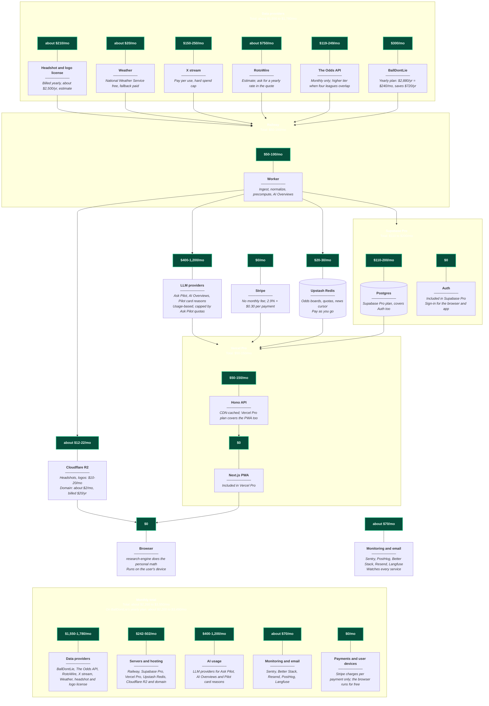

# PickPilot - Tech Stack, Build Plan and Developer Quote

Prepared November 4, 2026, from `Blueprint/Complete_Project_Blueprint.pdf` (421 pages, October 29, 2026 edition), as the developer's response to Clark's blueprint.

Assumptions behind this plan:

- **One developer working with AI coding tools**, contracted by Clark (the client and product owner).
- **The $50,000 phase-one budget is quoted two ways** (section 7): as the full development fee with API and hosting costs paid by Clark on top (Scenario A), or as a total cap through launch that covers the developer, APIs and hosting (Scenario B). Either way, vendor accounts are in Clark's name; the blueprint says the developer must not sign vendor contracts on Clark's behalf.
- **Design and brand are provided by Clark's side.** Architecture and code review are done by the developer.
- **PWA first.** The iOS app comes later and must reuse as much as possible.
- **Built to reach millions of users** without re-platforming.
- **Community is a later phase** (the blueprint itself keeps it outside the $50k).

Provider prices below were checked on November 4, 2026, where they are public. Prices marked "estimate" need a written quote before you commit.

---

## 1. The short version

| Layer | Choice |
| --- | --- |
| Language | TypeScript everywhere |
| Repository | pnpm + Turborepo monorepo (web now, iOS later, shared packages) |
| Web app (PWA) | Next.js (App Router) + React, Tailwind CSS, shadcn/ui (Radix), Serwist service worker |
| Client state | TanStack Query (server data), Zustand + IndexedDB (research slip), nuqs (URL state) |
| Charts | visx + custom SVG (threshold bars, shot chart, field panels) |
| API | Hono, mounted inside Next.js at first, deployable on its own later |
| Database, auth, storage | Supabase (Postgres, Supabase Auth, Storage) with Drizzle ORM |
| Background workers | One Node worker on Railway with pg-boss job queue |
| Cache and quotas | Upstash Redis |
| Images | Cloudflare R2 |
| AI | Vercel AI SDK, a fast inexpensive model for Ask Pilot, a stronger model for batch AI Overviews, Langfuse for tracing and cost |
| Payments | Stripe Billing + your own entitlements table (RevenueCat added with iOS) |
| Monitoring | Sentry, PostHog, Better Stack |
| Sports data | BallDontLie ALL-ACCESS (primary), The Odds API (secondary odds and history), RotoWire (news, injuries, lineups), X API pay-per-use (fast reports), National Weather Service (weather) |
| iOS later | Expo (React Native) app in the same monorepo |

The single most important design decision is **"compute once, serve millions"** (section 3). The single biggest running cost is **sports data** (sections 5 and 7.4).

---

## 2. What the blueprint requires that drives these choices

| Blueprint requirement | Technical consequence |
| --- | --- |
| Best price among the user's chosen books, exact-line matching, stale and changed-price states (GH09, RS08-RS10) | A canonical market model and a frequently refreshed odds feed |
| Historical hit rates with filters such as with/without teammates, opponent rank as of game date, venue and minutes; pushes and voids excluded (RS04, CH01-CH08, FL01-FL04) | A normalized game log per player and one heavily tested calculation engine |
| The same rules reused in Games, Players, Pilot, News trends and Community scoring | The calculation code lives in one shared package used by web, server and iOS |
| Ask Pilot: grounded answers, streaming, Stop, usage limits, cost monitoring | An LLM layer with tool calls into your own data, quotas and tracing |
| AI Overview per matchup, refreshed when lineups or injuries change | Generated per game in background jobs, never per user |
| News visible within 15 s at p95 after receipt, with corrections, conflicting reports and deduplication | Event ingestion, an append-only history model and fast delivery |
| Research slip survives refresh on the same device; share links are read-only snapshots | Local persistence (IndexedDB) plus a small server snapshot table |
| Six leagues from one framework: "do not duplicate the product per sport" | A sport registry (configuration) drives stats, sample windows, positions, filters and labels |
| Extensive accessibility (keyboard, focus, color never the only signal) | Accessible component primitives |
| Free versus paid access and AI quotas | Auth, subscriptions and an entitlements service |
| Community later: chat, media, moderation, settlement | Infrastructure that already supports realtime, storage and jobs |

Two gaps in the blueprint affect the plan:

1. **Only 1440 px desktop visuals exist.** Mobile layouts are explicitly "still to be specified". A PWA gets most of its traffic on phones, so Clark's design side needs to deliver the mobile layouts first, before the matching screens are built.
2. **Many advanced widgets depend on data that may not be affordable** (potential assists, rebound chances, play types, NFL routes and alignment, pitch tracking, same-game-parlay pricing). The blueprint already allows "Unavailable" states and itemized exclusions, so launch can ship without them.

---

## 3. Core architecture: compute once, serve millions

Almost everything a user sees is identical for every user: the slate, the odds board, a player's game log, matchup modules, AI Overviews, trends and news. Only a few things are personal: selected books, the research slip, preferences, Ask Pilot conversations and entitlements.

So:

- **Workers** pull provider data, normalize it, precompute views and write them to Postgres and Redis. Provider API calls do not grow with user count.
- **The API** serves those views as JSON with CDN cache headers (`s-maxage` plus `stale-while-revalidate`). A million users hit the CDN; your origin sees a few requests per key every few seconds.
- **The browser does the personal math:**
  - Best price among *your* books is computed client-side from the cached all-books odds board, so the board stays cacheable for everyone.
  - Hit rates, samples and filters are computed client-side from the player's cached normalized game log (two seasons is roughly 40-100 KB compressed). Filter changes are instant and cost zero server load.
- **Per-user server work** is limited to auth, preferences, share snapshots and Ask Pilot, which is protected by quotas.

```
        Providers: BallDontLie, The Odds API, RotoWire, X, weather
                                  |
                       [ worker on Railway ]
            ingest -> map IDs -> normalize -> precompute -> AI batch jobs
                       |                          |
              [ Supabase Postgres ]        [ Upstash Redis ]
                       \                          /
               [ Hono API inside Next.js on Vercel, CDN-cached ]
                        /                          \
       [ PWA: research-engine runs           [ Expo iOS app - later:
         in the browser ]                      same API, same packages ]
```

This keeps running costs low enough to be funded by subscription revenue as the product grows.

### 3.1 The running pieces

| Piece | Runs on | Its job | Talks to |
| --- | --- | --- | --- |
| **PWA** (`apps/web`) | Vercel | Server-renders public game and player pages for SEO; runs the interactive workspace in the browser; caches the app shell offline (Serwist); stores the research slip in IndexedDB | API, Supabase Auth, R2 images |
| **API** (`packages/api`, Hono) | Inside Next.js on Vercel | Serves shared data with CDN cache headers; handles personal requests (preferences, share links, Ask Pilot); receives Stripe webhooks | Postgres, Redis, LLM providers, Stripe |
| **Worker** (`apps/worker`) | Railway, always on | Pulls every provider feed on a schedule, normalizes it, precomputes the views the API serves, generates AI Overviews, reports feed health | Providers, Postgres, Redis, R2, LLM providers, Better Stack |
| **Postgres** | Supabase | Source of truth: the canonical sports model, markets, news history, users, entitlements, job queue (pg-boss) | API, worker |
| **Redis** | Upstash | Current odds boards, hot precomputed bundles, Ask Pilot quotas and rate limits, Trending counters, the News change cursor | API, worker |
| **Auth** | Supabase Auth | Sign-up and sign-in; issues the token the API checks on personal requests | PWA, API |
| **Images** | Cloudflare R2 | Headshots and logos, resized once by the worker | PWA |
| **Payments** | Stripe | Checkout and subscriptions; webhooks update the `entitlement` table | API |
| **Observability** | Sentry, PostHog, Better Stack, Langfuse | Errors, product analytics and feature flags, feed freshness and uptime, AI cost and tracing | All pieces |

The shared packages are what make one developer enough: `research-engine` (hit rates, samples, filters, settlement rules) runs in the browser for instant filtering, in the worker for News trends and Pilot trends, and in the API for Ask Pilot's evidence. `sports-config` tells every piece which stats, windows, positions and labels each league uses. `contracts` keeps the API and every client in agreement on data shapes.

### 3.2 The data pipeline (worker jobs)

Every provider adapter converts its data into the canonical model, mapping provider IDs through `provider_entity_map`. Nothing downstream ever sees a provider's raw format, so swapping or adding a provider only touches its adapter.

| Job | When it runs | Source | What it produces |
| --- | --- | --- | --- |
| Reference sync | Daily, plus on roster news | BallDontLie | Teams, players, rosters, venues; new headshots resized into R2 |
| Schedule and scores | Every 5 min on game days, every 30 s during games | BallDontLie | Fixture status changes: delayed, postponed, live, final |
| Box scores | When a fixture goes final, retried until complete | BallDontLie | `player_game`, `team_game`, `participation`, shot events by zone; triggers the rebuild jobs below |
| Rebuild bundles | After each final | Postgres | Each affected player's game-log bundle, team game logs, rank snapshots as of that date, usage shares |
| Odds | Every 30-60 s for games in the next 36 hours; every 15 min further out | BallDontLie (primary), The Odds API (extra books) | The current odds board per sport and date in Redis; price changes appended to `offer_change` |
| Closing lines | At each fixture's start | The Odds API | Stored closing line per market for historical Game Lines and closing-line research |
| News and injuries | Every 1-2 min on game days | RotoWire | `availability_event` rows, deduplicated, with corrections and history |
| Fast reports | Continuous stream connection | X filtered stream | "Reported" events, upgraded to "Confirmed" when RotoWire or an official source agrees |
| Lineups | Every 5 min from 2 hours before start | BallDontLie, RotoWire | `lineup_version` rows, expected versus confirmed per team |
| Weather | Hourly for outdoor games in the next 72 hours | National Weather Service, fallback provider | `weather_forecast` per fixture and venue |
| Pilot cards | After odds, lineups or projections change | Postgres, `research-engine` | Discovery cards with projection, rating and one reason; Trending ranks every 5 min from Redis counters |
| News trends | After each final and each line change | Postgres, `research-engine` | The Trends feed, recalculated or withdrawn when a line or status changes |
| AI Overviews | Morning of each game day, and again after a material lineup or injury change | Postgres, LLM | One cached overview per game, with sources and data timestamp |
| Feed health | After every successful pull | All of the above | A heartbeat per feed; Better Stack alerts when one goes quiet, and the PWA shows "Updates delayed" |

### 3.3 How data is served

The API has three kinds of endpoints:

| Kind | Examples | Caching |
| --- | --- | --- |
| **Live shared data** | Odds board for a sport and date, News change cursor | CDN caches for 2-10 s and serves a slightly stale copy while refreshing, so the origin sees about one request per key every few seconds regardless of user count |
| **Versioned bundles** | Player game log, team game log, matchup modules, Pilot cards, AI Overview | The URL includes a version (for example the latest completed game ID). New data means a new URL, so the CDN can cache each version for a day with no purging |
| **Personal** | Preferences, share-link creation, Ask Pilot, entitlements | Never cached; requires a signed-in token; rate limited in Redis |

### 3.4 What happens when a user does something

**Opens Games.** The page reads sport and date from the URL and renders the slate on the server, so it appears instantly and can be indexed. The browser then fetches that date's odds board (CDN-cached) and computes the best price for each market among the user's selected books. It polls the board every 15-30 seconds while the tab is visible and stops when the tab is hidden.

**Clicks an odd.** The selection (fixture, market, side, exact line, period) goes into the research slip store, which saves it to IndexedDB so it survives refresh. The slip fetches the relevant team game logs (versioned bundles), and `research-engine` calculates hit rates, samples, filters and correlation in the browser. Sportsbook comparison reads the same odds board already in memory. Nothing personal reaches the server.

**Shares the slip.** The browser sends the slip contents to the API, which stores a read-only snapshot and returns a short link. Anyone opening it sees the snapshot prices labeled as such, alongside current prices.

**Opens a player in Players.** The browser fetches the player's game-log bundle: two seasons of games with participation, opponent ranks as of each date, minutes, and shot events by zone. Every chart, filter, sample change, threshold change and the shot chart are calculated locally from that one file, so they respond instantly.

**Browses Pilot.** The discovery grid is a cached, precomputed list of cards. Opening a pick sends a small "opened" event to Redis, which feeds the deduplicated 24-hour Trending count.

**Asks Pilot a question.** The API checks the user's token and daily quota, then starts a streaming model call. The model can only answer through tools (`get_slate`, `get_player_prop`, `get_trend_sample`, `get_injuries`) that read the same data the screens use, so every claim has a source and timestamp. Pick cards arrive as structured results and render with the same card component as the discovery grid. Stop cancels the call. Langfuse records the cost, and the quota counter increases.

**Subscribes.** Stripe Checkout handles payment. Stripe's webhook updates the `entitlement` table, and the next request picks up the new access level and Ask Pilot allowance.

### 3.5 What happens when the real world changes

**A key player is ruled out.** RotoWire or the X stream delivers the report. The worker matches it to the canonical player, deduplicates it and writes an `availability_event`. It then advances the News cursor in Redis, marks that game's AI Overview for regeneration, recalculates affected Pilot cards and trends, and publishes a new matchup bundle version. Browsers on News see the cursor change within about 5 seconds and show the "New updates" banner without moving what the user is reading. Games, Players and Pilot pick up the same status on their next fetch, so no tab contradicts another.

**A line moves.** The odds job writes the new price to the board and records the change. Within one polling cycle every open card shows the new best price. A selection already in someone's slip keeps its original line and price snapshot, with the new quote shown beside it, as the blueprint requires.

**A game ends.** The box-score job loads the final stats and participation. The rebuild jobs publish new versions of each player's and team's bundles, rank snapshots and trends. Tomorrow's research includes tonight's game automatically.

### 3.6 When something fails

- **A provider is down:** the last good data stays on screen with its timestamp and a stale or "Updates delayed" label. Missing values show "Unavailable", never zero.
- **One matchup module fails:** each module loads and retries on its own, so the rest of the page keeps working (BM13).
- **AI generation fails:** the statistical sections remain fully usable; the overview shows its unavailable state.
- **The worker restarts:** jobs are idempotent and queued in Postgres, so they resume without duplicating news events or price changes.

---

## 4. Recommended stack, with reasons

### 4.1 Language and repository

- **TypeScript everywhere.** One language for web, API, workers and the future iOS app. AI coding tools are strongest in TypeScript and React, which matters a lot when one developer builds everything.
- **pnpm + Turborepo monorepo.** The iOS app later drops into `apps/mobile` and reuses the packages.

```
pickpilot/
  apps/
    web/              Next.js PWA (also hosts the API at first)
    worker/           ingestion, scheduled jobs, AI batch generation
    mobile/           Expo iOS app (later)
  packages/
    api/              Hono routes and OpenAPI spec (mounted in web, deployable alone)
    contracts/        Zod schemas, API types, generated typed client
    research-engine/  samples, filters, hit rates, settlement rules (pure TS, no I/O)
    sports-config/    league registry: stats, windows, positions, filters, labels, rank populations
    db/               Drizzle schema, migrations, query helpers
    providers/        one adapter per data vendor -> canonical model
    ai/               Ask Pilot tools, prompts, grounding, evaluations
    design-tokens/    colors (#17181A, #3F83F8, ...), spacing, typography
```

### 4.2 Web app (the PWA)

| Concern | Choice | Why |
| --- | --- | --- |
| Framework | **Next.js (App Router) + React** | Server-rendered game and player pages that search engines can index. SEO is a major acquisition channel for betting research sites. Interactive client components for the research workspace. React skills carry over to React Native for iOS. |
| PWA | **Serwist** + Web App Manifest | Installable app, cached app shell, offline fallback showing timestamped cached data (News requires this). Web Push works on iOS 16.4+ for installed PWAs, so alerts are possible later without the App Store. |
| Styling | **Tailwind CSS** with tokens from `design-tokens` | The blueprint defines one shared palette for all five tabs. Tokens in code keep every tab consistent. |
| Components | **shadcn/ui on Radix** | Accessible drawers, tabs, menus, dialogs and focus handling. The accessibility requirements (GH17, ST03) are extensive. |
| Server data | **TanStack Query** | Each matchup module loads, fails and retries on its own (BM13). Polls only while visible. Also works in React Native. |
| URL state | **nuqs** | Sport, date, player, stat and sample live in the URL. Back navigation, refresh-opens-the-same-game (BM01), deep links and sharing come for free. |
| Local state | **Zustand** persisted to IndexedDB | The research slip survives refresh and restores thresholds and filters (RS09). Also works in React Native. |
| Charts | **visx** + custom SVG | The charts are bespoke: threshold bars with hit/miss colors, the six-zone shot chart, football field panels, spray charts and a radar with documented scales. |
| Tables | **TanStack Table** + **TanStack Virtual** | Wide game logs with horizontal scrolling, long slates and player lists. |
| Validation | **Zod** | The same schemas validate data on web, API and iOS. |

Alternatives considered and rejected:

- **Expo / React Native Web for web and iOS from day one.** Weaker for a dense desktop research workspace with hover tooltips and drawers, and for SEO. It would compromise the PWA to make the later app slightly easier.
- **Flutter.** Canvas-rendered web with weak SEO, accessibility and PWA support.
- **Plain Vite single-page app.** Works, but loses the server-rendered SEO pages.

### 4.3 Backend

| Concern | Choice | Why |
| --- | --- | --- |
| API | **Hono** with `@hono/zod-openapi`, mounted in a Next.js route handler | One deployment to manage while the team is one developer. Generates an OpenAPI spec and a typed client, so the iOS app later uses the same contract. Hono runs anywhere, so the API can move to its own server when needed without rewriting. |
| Database | **PostgreSQL on Supabase** | Relational data with heavy joins (fixtures, players, participation, markets). Supabase also provides Auth, Storage and Realtime, which Community will need, without extra vendors. It is standard Postgres, so there is no lock-in. |
| ORM | **Drizzle ORM** | Type-safe SQL, simple migrations, very AI-friendly. |
| Auth | **Supabase Auth** (email, Google, Sign in with Apple, passkeys) | Inexpensive at millions of monthly users. Per-user-priced auth services become very expensive at that scale. Sign in with Apple is required for the iOS app. Works in Expo. |
| Cache, quotas, counters | **Upstash Redis** | Hot precomputed views, Ask Pilot daily quotas and rate limits, and Pilot's "Trending" deduplicated 24-hour unique opens. |
| Jobs | **pg-boss** inside the worker | Retries, schedules and idempotent jobs in Postgres, with no extra vendor. |
| Worker hosting | **Railway** (Docker) | Ingestion needs long-running processes (odds pollers, the X stream) that serverless functions cannot hold. Cheap and low-maintenance. Docker keeps a later move to AWS straightforward. |
| Web hosting | **Vercel** | Best Next.js hosting, preview deployments, built-in CDN. Images are served from R2 to control bandwidth cost. |
| Images | **Cloudflare R2** | Headshots and logos are resized once at ingestion and served with near-zero bandwidth cost. |
| Realtime | Phase one: **CDN-cached polling**. Community phase: Supabase Realtime or Ably | Polling every few seconds through the CDN meets the 15 s News target and scales cheaply. WebSockets are added only when Community chat needs them. |
| Odds history | Partitioned Postgres table storing **price changes only** | Keeps history small. Consider ClickHouse only if historical-line analytics outgrow Postgres. |
| Search | Postgres trigram search | Player and team search is small. |

### 4.4 AI (Ask Pilot and AI Overview)

- **Vercel AI SDK** in the API: streaming, abort for the Stop button, tool calling, and the ability to switch model providers.
- **Two model tiers.** A fast, inexpensive model for Ask Pilot conversations; a stronger model for batch-generated AI Overviews. Keep two providers configured for failover. Pick the actual models by testing against your own evaluation set; model pricing changes often.
- **Grounding.** The model never answers from memory. It calls tools such as `get_slate`, `get_player_prop`, `get_trend_sample` and `get_injuries`, which return a timestamped data snapshot. Replies cite that snapshot's source and update time, as Pilot requires.
- **Cost control.** AI Overviews and Pilot card reasons are generated per game in worker jobs and cached, so their cost depends on the number of games, not users. Ask Pilot is the only per-user AI cost. It is capped with daily quotas in Redis, tied to subscription tier.
- **Tracing.** Langfuse (free tier to start) records prompts, tool calls, latency and token cost per user.
- **Projections and ratings.** The blueprint forbids the frontend from inventing a rating. Ask RotoWire to include its projections in the news quote. If that is too expensive, build a documented v1 model in the worker (recent per-minute rates times expected minutes, adjusted for opponent) and publish its method. The 1-5 Pilot rating is derived on the server from a written formula.

### 4.5 Payments, analytics and operations

| Concern | Choice | Why |
| --- | --- | --- |
| Subscriptions | **Stripe Billing** + your own `entitlements` table | Free versus paid access and AI allowances. Entitlements in your own database mean Apple in-app purchases later are one more source, not a rewrite. Add **RevenueCat** when iOS ships. |
| Analytics and feature flags | **PostHog** (free tier) | Funnels, flags for rolling out sports and tabs, session replay. |
| Errors | **Sentry** | Web, API and worker. |
| Uptime and feed freshness | **Better Stack** | A monitor for each feed's last successful check. News requires an "Updates delayed" state driven by this. |
| Email | **Resend** | Account and transactional mail. |
| Testing | **Vitest**, **Playwright**, **axe-core**, **k6** | The blueprint contains exact acceptance examples. They become `research-engine` unit tests on day one (section 8). News requires a demonstrated load target before launch. |
| CI/CD | **GitHub Actions** + Vercel previews + Railway deploys | Type check, lint, tests and migrations on every change. With one developer, automated tests act as the reviewer. |

### 4.6 How it is built

**Environments**

| Environment | What runs | Data |
| --- | --- | --- |
| Local | Next.js dev server, worker in watch mode, Supabase CLI (local Postgres and Auth in Docker), local Redis | Recorded provider responses (below); no API spend |
| Preview | A Vercel deployment per pull request, a Supabase branch database | Seeded test data |
| Staging | Full stack: Vercel, Railway worker, staging Supabase and Redis | Real provider feeds, so ingestion is proven before production |
| Production | Full stack | Real feeds and real users |

**Recorded provider data.** Early in Phase 0 the worker saves real responses from each provider (a full NBA game day, a postponed game, a late scratch, a line move) as fixture files. Local development and automated tests replay them. This makes tests repeatable, avoids paying for API calls during development, and preserves awkward real-world cases permanently.

**Building each feature as a vertical slice.** Every blueprint requirement goes through the same steps, in this order:

1. **Data:** confirm the field exists in the coverage matrix; add the adapter mapping and schema change (Drizzle migration).
2. **Rules:** write `research-engine` tests named after the requirement ID (for example `RS04 excludes pushes from the denominator`), then the logic.
3. **API:** add the endpoint and its Zod contract; the typed client is generated from it.
4. **Screen:** build the component from the shared design tokens, including its loading, empty, error, stale and "Unavailable" states.
5. **Acceptance:** a Playwright test for the blueprint's acceptance example, plus an automated accessibility check.

**Working with AI coding tools.** The repository carries project rules for the AI assistant: the blueprint's non-negotiables (missing data is never zero, pushes leave the denominator, exact-line matching, timestamps on every source), the folder layout and the vertical-slice steps. The assistant writes most of the code, and the tests and type checks decide whether it is correct. Each requirement ID links to its test and screen in a coverage table, which doubles as the acceptance checklist for each milestone.

**Continuous integration and deployment.** Every pull request runs type checks, linting, unit tests, migration checks and Playwright tests against its preview deployment. Merging to the main branch deploys to staging automatically. Production deploys are promoted from staging after a check of feed health. Database migrations always run before the code that needs them.

**Releasing safely.** New tabs and sports ship hidden behind PostHog feature flags, are switched on for beta users first, then for everyone. Turning a flag off is the rollback.

---

## 5. Sports data: the recommended provider set

Data is the hardest and most expensive part of this product. Enterprise providers such as Sportradar, Stats Perform and SportsDataIO's commercial license are quote-only and usually cost more per year than this entire budget. The recommended set below covers most of the blueprint for about $1,000-1,500 per month once everything is running.

| Need | Provider | Cost | What it covers | Gaps |
| --- | --- | --- | --- | --- |
| Stats, box scores, play-by-play, odds, player props, lineups, injuries | **BallDontLie ALL-ACCESS** | $299.99/mo or $2,879.90/yr (public price) | All six leagues. NBA play-by-play includes shot coordinates and the same six zones the shot chart specifies (restricted area, paint, mid-range, both corner threes, above-the-break three). NBA expected/confirmed lineups. MLB pitches and pitch-type stats. NFL snap counts and advanced passing/rushing/receiving. Game odds and props with deep links for DraftKings, FanDuel, BetMGM, BetRivers and Caesars. Commercial use permitted. | No historical player-prop archive (you store your own from day one). College basketball has game odds but no player props, injuries or lineups. Raw data cannot be resold. |
| More books, alternate lines, historical closing lines | **The Odds API** | $30-$119/mo depending on credit tier | 40+ books, props for most leagues, historical main-market odds since 2020 and props since May 2023. Powers historical Game Lines (BM11), closing-line context (AF06, AR08) and acts as a backup feed. | Credit-based. Poll carefully. |
| Fast, trusted injury news, lineups, depth charts, projections | **RotoWire** syndicated feeds | Estimate $500-$1,000/mo; quote required | Powers ESPN, Yahoo, DraftKings and FanDuel. Player news, injuries, expected/confirmed lineups (NBA, WNBA, MLB), depth charts and projections. Fills the college injury gap. | MLB lineups and probable pitchers are separate feeds with separate costs. History limited to 2 weeks unless arranged. |
| Reports first published on X | **X API pay-per-use filtered stream** | $0.005 per post delivered; hard spend cap | An approved list of team, league and beat-reporter accounts, with keyword-filtered rules so you only pay for injury and lineup posts. | One connection, no backfill on this tier. Use recent search to fill gaps after disconnects. |
| Weather for NFL, CFB, MLB | **National Weather Service API** (free, public domain) + a paid fallback (Open-Meteo or Visual Crossing) | $0-$30/mo | Kickoff and first-pitch forecasts, hourly detail. Combine with your own venue table (roof type, field orientation). | The Toronto Blue Jays and international NFL games need the fallback provider. |
| Same-game and complete-slip pricing (RS08) | **OpticOdds** (later) | Quote-only, likely several thousand per month | Correlated parlay prices per book, deep links, streaming. | **Deferred.** The blueprint allows "complete quote unavailable" while still showing individual prices. Add when revenue supports it. |
| Advanced tracking (potential assists, rebound chances, play types, NFL routes and alignment) | Second Spectrum/Sportradar, PFF, FTN | Enterprise | | **Deferred.** These modules show "Unavailable" until licensed. |
| Headshots and team logos | Licensed image source | Reserve $2,500; quote required | Required in every tab by the blueprint. | The blueprint mockups use ESPN and NBA.com images, which are not licensed for PickPilot's use. Clark's attorney should confirm what is acceptable. |

Rules for the data layer:

- **Canonical IDs from day one.** Every provider's league, team, player, fixture and market ID maps to your own ID in a `provider_entity_map` table. This prevents a card from ever showing another game's markets, which the blueprint calls out explicitly.
- **Store everything you receive.** BallDontLie does not keep prop history, so your own archive of lines becomes a long-term asset for closing-line research and Pilot model validation.
- **Fill in the blueprint's coverage response (CV02 and SQ01) for each provider during Phase 0.** For every blueprint item, mark it available, gap or substitute. This tells you exactly what launches and what shows "Unavailable".

---

## 6. Data model outline

- **Reference:** `league`, `season`, `team`, `player`, `venue` (roof, orientation), `sportsbook`, `provider_entity_map`
- **Schedule and results:** `fixture` (status, start time, neutral site, doubleheader number), `team_game`, `player_game` (typed core columns plus sport-specific `stats jsonb` validated by `sports-config`), `participation` (who actually played, for with/without filters), `team_rank_snapshot` (ranks as of each date, so historical filters never use today's rank)
- **Markets:** `market` (fixture, entity, stat, period, side, line, settlement basis), `offer_current` (Redis, mirrored to Postgres), `offer_change` (partitioned history)
- **News:** `availability_event` (append-only, with source, reported versus confirmed, corrections), `lineup_version`, `weather_forecast`
- **AI and Pilot:** `projection` (source and version), `ai_overview` (sources, data timestamp), `conversation`, `message`, `usage_counter`
- **Users:** `user_profile`, `user_preferences` (books, timezone, last league), `entitlement`, `share_snapshot`
- **Community (later):** posts, scored picks (immutable), groups, memberships, messages, challenges, moderation queue

---

## 7. Quote

The project has two kinds of cost:

- **The development fee**, paid to the developer for building the product.
- **Operating costs**: data and API licenses, hosting and servers, and AI model usage (the LLM API behind Ask Pilot, AI Overviews and Pilot card reasons), all in section 7.4. Every vendor account is in Clark's name and paid by Clark directly; the developer gets team access. Clark owns all vendor contracts, data and accounts from day one, as the blueprint requires.

Design and brand are provided by Clark's side. The developer's own AI coding tools are paid by the developer. Clark's own business costs (legal, trademark, insurance, marketing) are outside this quote.

The quote is offered in two versions (sections 7.5 and 7.6):

- **Scenario A:** the full $50,000 is the development fee; operating costs are paid by Clark on top.
- **Scenario B:** $50,000 is the total spending cap through launch, covering the development fee and all operating costs.

### 7.1 Phase-one scope and effort

**Scope:** NBA across all four launch tabs (Games, Players, Pilot, News), built on a shared foundation designed for all six leagues. It includes the installable PWA, accounts, Stripe subscriptions and AI quotas, and the public launch. Section 9 lists exactly what ships and what waits.

**Included in the development fee:**

- Discovery, provider evaluation and the blueprint coverage matrix (CV02/SQ01)
- All development, architecture and code review, testing, deployment and documentation
- Security hardening and load testing before launch
- 30 days of bug fixes after public launch

**Estimated effort:**

| Work | Hours |
| --- | --- |
| Phase 0: discovery, provider evaluation, coverage matrix, open decisions | 60 |
| Foundation: repository, data model, NBA ingestion, `research-engine`, API, PWA shell, accounts | 200 |
| Games tab (NBA) | 180 |
| Players tab (NBA) | 240 |
| Pilot tab (NBA), including Stripe subscriptions and quotas | 180 |
| News tab (NBA) | 140 |
| Launch hardening: load test, accessibility, security fixes | 60 |
| Demos, acceptance reviews and communication | 40 |
| **Total** | **1,100** |

### 7.2 Payment milestones

| Milestone | Delivered | Target date | Scenario A | Scenario B |
| --- | --- | --- | --- | --- |
| M0 | Contract signed, kickoff | November 2026 | $10,000 | $8,000 |
| M1 | Foundation and walking skeleton: today's NBA games with best prices, deployed as an installable PWA | End of December 2026 | $7,500 | $6,000 |
| M2 | Games tab (NBA) accepted | End of January 2027 | $7,500 | $6,000 |
| M3 | Players tab (NBA) accepted; private beta live | Mid-March 2027 | $10,000 | $8,000 |
| M4 | Pilot tab (NBA) accepted; subscriptions live | End of April 2027 | $7,500 | $6,000 |
| M5 | News tab (NBA) accepted; public launch | Late May 2027 | $7,500 | $5,250 + unused reserve |
| | | **Total fee** | **$50,000** | **$39,250 + up to $1,500** |

Acceptance for each milestone uses the blueprint's own acceptance checks for that tab. Clark has 5 business days to report defects in writing. A milestone with no reported defects in that window counts as accepted.

### 7.3 Additional sports: the full requested quote

The blueprint asks for the full requested quote alongside a phase-one version that fits the budget. Each additional sport covers all four tabs and is a separate fixed-price milestone, timed to its season:

| Sport | Estimated hours | Fixed price | Target delivery |
| --- | --- | --- | --- |
| WNBA | 100 | $5,000 | June 2027 |
| MLB | 260 | $13,000 | July 2027 |
| NFL | 280 | $14,000 | August 2027 |
| CFB | 140 | $7,000 | September 2027 (reuses NFL components) |
| CBB | 120 | $6,000 | October 2027 (reuses basketball components) |
| **Total** | **900** | **$45,000** | |

**Full requested quote (six leagues, four tabs, excluding Community): $95,000** in Scenario A. Each sport is billed 50% at start and 50% on acceptance. Adding sports raises operating costs by roughly $100-300 per month (a larger Odds API credit tier and more X reporter accounts during overlapping seasons); BallDontLie ALL-ACCESS already covers every league.

### 7.4 Operating costs: APIs, hosting, servers and AI usage

**Before launch (November 2026 to late May 2027):**

| Item | Cost | Basis |
| --- | --- | --- |
| BallDontLie ALL-ACCESS, annual | $2,880 | Public price $2,879.90/yr. Free tier in November; the annual plan bought in December covers through November 2027. |
| The Odds API | $355 | 100K-credit plan at about $59/mo, December to May |
| RotoWire news, injuries, lineups, projections | $1,500 | Estimate at about $750/mo, April and May only; quote required |
| X API pay-per-use | $250 | About $125/mo, April and May, with a hard spend cap |
| Weather fallback | $100 | National Weather Service itself is free |
| Licensed headshots and logos | $2,500 | Estimate; quote and legal review required |
| **APIs and data subtotal** | **$7,585** | |
| Vercel Pro (web and API) | $140 | $20/mo |
| Supabase Pro with small compute (database, auth, storage) | $280 | About $40/mo |
| Railway (ingestion worker) | $180 | About $30/mo, December to May |
| Upstash Redis | $40 | Pay as you go |
| Cloudflare R2 and domain | $40 | Image storage plus domain registration |
| Monitoring and email (Sentry, Better Stack, Resend, PostHog, Langfuse) | $30 | Free tiers until launch |
| **Hosting and servers subtotal** | **$710** | |
| LLM API (Ask Pilot, AI Overviews, Pilot card reasons) | $950 | About $50/mo while building (November to February), about $250/mo during the March-May beta |
| **AI usage subtotal** | **$950** | |
| **Total before launch** | **about $9,250** | |

**After launch (monthly, at beta scale of up to about 10,000 monthly users):**

| Item | Per month |
| --- | --- |
| BallDontLie (prepaid until December 2027; about $240/mo equivalent after) | $0-240 |
| The Odds API, 5M-credit plan | $119 |
| RotoWire (estimate) | $750 |
| X API | $150 |
| Weather fallback | $20 |
| Hosting and servers: Vercel usage, larger Supabase compute, Railway, Redis, R2 | $180-430 |
| Monitoring and email on paid tiers | $70 |
| LLM API, capped by Ask Pilot quotas | $300-1,000 |
| **Total** | **about $1,600-2,800** |

**Upfront costs (paid once, each covering 12 months):**

| Item | Paid | Cost | Covers |
| --- | --- | --- | --- |
| BallDontLie ALL-ACCESS, annual | December 2026 | $2,880 | December 2026 to November 2027 |
| Headshot and logo license (estimate) | May 2027 | $2,500 | May 2027 to April 2028 |
| Domain | November 2026 | $20 | November 2026 to October 2027 |
| **Total upfront** | | **$5,400** | |

**Monthly costs by period:**

| Period | Per month | What is running |
| --- | --- | --- |
| November 2026 | about $110 | Vercel, Supabase and AI usage while building |
| December 2026 to February 2027 | about $215 | Adds the Railway worker and The Odds API |
| March 2027 | about $450 | Private beta: weather feed added, AI usage rises with beta testers |
| April to May 2027 | about $1,320 | Adds RotoWire and the X stream before launch |
| June to October 2027 (NBA live, other sports added) | about $1,600-2,550 | Larger Odds API plan, paid monitoring, hosting and AI usage growing with users |
| From November 2027 (all six sports live) | about $1,750-3,050 | Plus the yearly renewals: BallDontLie $2,880 in December, headshots $2,500 in May |

Upfront $5,400 plus about $3,850 of monthly costs from November to May gives the pre-launch total of about $9,250.

**Steady state with all six sports live (from about November 2027), at up to about 10,000 monthly users:**

| Item | Per month |
| --- | --- |
| BallDontLie (annual plan, monthly equivalent) | $240 |
| The Odds API (higher credit tier when NFL, CFB, NBA and MLB overlap) | $119-249 |
| RotoWire (estimate) | $750 |
| X API (more reporter accounts across six sports) | $150-250 |
| Weather fallback | $20 |
| Headshot/logo license (estimate, if renewed annually) | $210 |
| Hosting and servers | $250-500 |
| Monitoring and email | $70 |
| LLM API (more games means more AI Overviews; Ask Pilot quota-capped) | $400-1,200 |
| **Total** | **about $2,200-3,500** |

**Cost map (steady state, per month; yearly plans shown as their monthly equivalent):**



Every green box is the monthly price of the service directly beneath it. Each group heading shows the total of the green boxes inside it. The Monthly total section at the bottom adds everything up by category. Monitoring watches every service, so it is drawn without connecting arrows. Data providers total about $1,550-1,780 per month with BallDontLie billed monthly, or $1,490-1,720 on its yearly plan. Everything together comes to about $2,200-3,500 per month on the yearly plans; paying BallDontLie monthly ($300) instead of yearly ($240 equivalent) adds $60 per month. The iOS app is not shown; its costs start only when it is built (section 9.4).

**Monitoring and email, line by line (about $70 per month after launch; approximate public prices):**

| Service | What it watches or does | Plan | Per month |
| --- | --- | --- | --- |
| Sentry | Crashes and errors in the PWA, API and worker, with the user's steps before the error and slow pages or endpoints | Team | about $26 |
| Better Stack | Uptime checks on the site and API, a heartbeat for every data feed, phone and SMS alerts, public status page | Paid responder | about $25 |
| Resend | Account emails: sign-up confirmation, sign-in links, password resets, subscription notices | Pro | $20 |
| PostHog | Product analytics, funnels to subscription, session replays, and the feature flags used to release new tabs and sports | Free tier (1M events) | $0 |
| Langfuse | Every AI call: prompt, tool calls, tokens, cost, latency and answer quality | Free tier, Core at $29 when exceeded | $0-29 |

Before launch everything runs on free tiers. At beta scale, Sentry's free one-user plan and Better Stack's free email-only alerts can also be used, which brings this line down to about $20 per month until traffic grows.

Costs are seasonal: lowest in summer (MLB and WNBA only), highest in September-October when four leagues overlap.

RotoWire is the largest and least certain line. Launching with BallDontLie injuries plus the X stream, and adding RotoWire later, saves about $1,500 before launch and $750 per month after. Running costs at larger scale are in section 7.9.

### 7.5 Scenario A: $50,000 to the developer, operating costs on top

| | Amount |
| --- | --- |
| **Developer receives** | **$50,000** (about $45/hr over 1,100 hours) |
| Clark pays vendors before launch | about $9,250 |
| **Clark's total through launch** | **about $59,250** |
| Clark pays vendors after launch | about $1,600-2,800 per month |

Clark should hold about 10% extra on the operating budget in case provider quotes come in higher than these estimates.

### 7.6 Scenario B: $50,000 total cap, covering everything through launch

| | Amount |
| --- | --- |
| Operating costs before launch (section 7.4) | $9,250 |
| Reserve for provider quotes above estimate | $1,500 |
| **Developer receives** | **$39,250**, plus whatever is left of the $1,500 reserve at launch (about $36-37/hr) |
| **Clark's total through launch** | **$50,000** |

How it works:

- Vendor accounts stay in Clark's name. Clark pays vendors directly from the operating budget, and the developer's fee is the remainder, paid on the Scenario B milestones in section 7.2.
- If operating costs exceed $10,750 before launch, the developer and Clark agree in writing which item to drop or defer (RotoWire first), so the $50,000 cap holds.
- The cap covers costs **through launch**. Running costs after launch (about $1,600-2,800 per month) are paid by Clark or from subscription revenue.

**Variant B2: the cap also covers the first three months after launch (June to August 2027).** That adds about $7,000 of running costs, so the developer receives **about $32,250**, plus any unused reserve (about $29-31/hr).

### 7.7 Comparing the two scenarios

| | Scenario A | Scenario B | Variant B2 |
| --- | --- | --- | --- |
| Developer receives | $50,000 | $39,250-40,750 | $32,250-33,750 |
| Operating costs through launch | Clark, on top (about $9,250) | Inside the $50,000 | Inside the $50,000 |
| Running costs, June-August 2027 | Clark, on top | Clark, on top | Inside the $50,000 |
| Clark's total through launch | about $59,250 | $50,000 | $50,000 |
| Who carries the risk of higher API prices | Clark | Shared, via the reserve | Shared, via the reserve |

### 7.8 Contract terms

- **Fixed scope.** Scope is the blueprint items listed in section 9 plus the acceptance checks. Anything else is a change request at $60/hr, estimated in writing and approved before work starts.
- **Data gaps are not defects.** If a licensed feed cannot supply a blueprint item, it ships with the blueprint's "Unavailable" state and is itemized in the coverage matrix.
- **Client dependencies.** Delays in Clark's decisions, design deliveries or vendor contracts move milestone dates by the same amount.
- **Ownership.** All PickPilot code transfers to Clark on full payment of each milestone. The developer keeps the right to reuse general techniques and non-PickPilot-specific tooling.
- **Post-launch support retainer: $2,000/mo** for up to 30 hours of monitoring, data-feed fixes, provider changes and small improvements, with a 3-month minimum. Extra hours at $60/hr.
- **Not included:** Community (separate quote, per the blueprint), the iOS app (section 9.4), enterprise data integrations (complete-slip parlay pricing, advanced tracking feeds), design and brand, and Clark's legal and marketing costs. Operating costs are outside the fee in Scenario A and inside the cap in Scenario B, as described above.

### 7.9 Running costs as the product grows (monthly, rough)

| Scale | Data | Hosting | AI usage | Total per month |
| --- | --- | --- | --- | --- |
| Beta, up to about 10,000 monthly users | $1,050-1,300 | $250-500 | $300-1,000 | about $1.6k-2.8k |
| 100,000 monthly users | $1,500-3,000 | $500-1,500 | $1,000-3,000 | about $3k-7.5k |
| 1,000,000 monthly users | $5,000-15,000 (enterprise feeds) | $5,000-15,000 | $5,000-20,000 | about $15k-50k |

AI usage is the line that grows fastest with users, because every Ask Pilot question is a paid model call.

At 1 million monthly users, even 2% paying $20/mo is $400k per month in revenue, so the economics work if subscriptions start at public launch. Ask Pilot quotas tied to subscription tier are the main lever that keeps AI cost below revenue. Sportsbook affiliate revenue can add more, but most states require affiliate registration or licensing first; Clark's attorney should confirm which states before affiliate links are added.

---

## 8. Day-one tests for `research-engine` (taken from the blueprint)

These are written before the features. With AI writing much of the code, they are what keeps the numbers correct.

- 10 appearances with 6 hits, 3 misses, 1 push -> "6 of 9 graded games, 66.7%", with 1 push shown separately (Players section 8).
- 8 wins, 1 loss, 1 push -> 8/9, 89%, not 80% (Pilot section 6).
- Last 10 requested but only 3 qualifying games -> shows 3, never pads (CH06).
- Over means strictly greater than the line; Under strictly lower; "At least" is a separate condition (PC06).
- DNP is excluded, never counted as a zero; a played zero is a valid zero (CH05).
- No decided results -> "No matching games" or unavailable, never 0% (RS04).
- Combined perspective counts a shared fixture once (RS04).
- A saved Over 24.5 selection stays at 24.5 when the user researches 25.5 (Players acceptance examples).
- MLB "5.2 IP" = 17 outs (SQ04).
- BA = H/AB and ISO = (2B + 2x3B + 3xHR)/AB, never divided by PA (MB06).
- Community scoring at -110: 6-4 -> +1.45u, 60% hit rate, 14.5% ROI; adding a push changes neither denominator (C02).

---

## 9. Build plan for one builder with AI

### 9.1 Sequencing logic

- **NBA first.** The blueprint uses NBA as the master example for every tab, and the NBA season runs through mid-June 2027.
- **Public launch around the NBA Playoffs (late May 2027).** Playoffs are a high-interest window, and it gives six months of build time.
- **WNBA right after launch.** Its season starts in May and it is mostly NBA configuration.
- **MLB over the summer.** The season runs through September.
- **NFL and CFB for the September 2027 kickoff.** Their current seasons are nearly over, so building them now would launch into the off-season.
- **CBB last, for the November 2027 season.** It has the weakest affordable data (no props, injuries or lineups from BallDontLie) and the most special cases (~360 teams, neutral sites, transfers).
- **Community and the iOS app** follow as separately quoted phases.

### 9.2 What ships at launch and what waits

To fit one builder and $50k, these blueprint items ship as labeled "Unavailable" states or wait for a later release. The blueprint already permits each of them:

- Complete-slip and same-game-parlay quotes (RS08): individual prices and comparison ship; the "Best complete slip" badge waits for a parlay-pricing feed.
- Advanced tracking widgets without affordable data: potential assists, rebound chances, play types, NFL target alignment and routes.
- Cross-device slip sync and named slips (the blueprint calls these separate scope).
- Watchlists, push/email/SMS alerts and the optional Articles module (the blueprint prices them separately).
- Long-term Ask Pilot history across devices (phase one keeps one conversation per browser session, as the blueprint specifies).

The confirmed must-haves stay in: best-price cards, the full research slip, the matchup page, the Players chart and filters, the dynamic shot chart, Ask Pilot, and the News injuries feed.

### 9.3 Phases and calendar

**Phase 0 - Decide and de-risk (November 2026, 4 weeks; starts at milestone M0)**

- Evaluate BallDontLie and The Odds API on their free tiers. Request quotes from RotoWire (news, injuries, lineups, projections) and a headshot source for Clark to sign. Fill in the coverage matrix (section 5).
- Agree with Clark's design side on the delivery order of the mobile layouts (Games and Players first).
- Settle the blueprint's open decisions that affect architecture: what anonymous, free and paid users can see; default sportsbooks; primary-line policy; Ask Pilot daily allowance; how far back history goes.
- Technical spike: ingest one real NBA day and render one game card with the best price across two books, deployed as an installable PWA.
**Phase 1 - Foundation (December 2026, 4-5 weeks; milestone M1)**

- Monorepo, CI, preview/staging/production environments, Sentry, PostHog.
- `design-tokens` and base components in the shared palette.
- Supabase schema for reference data, schedule, results and markets, including `provider_entity_map`.
- `sports-config` with NBA fully defined; other leagues stubbed.
- `research-engine` with the section 8 tests passing.
- NBA ingestion: teams, players, two seasons of box scores, participation, play-by-play shots, schedule and live odds.
- API with CDN caching, typed client, PWA shell (navigation, sport/date/book controls, installable, offline fallback). Auth and user preferences.

**Phase 2 - Games tab, NBA (January 2027, 5 weeks; milestone M2)**

- Home slate with best-price cards, sportsbook selector, every loading/empty/error/stale state.
- Research slip: add/remove, grouping, samples, filters, game log, correlation, sportsbook comparison, persistence, undo, share snapshots.
- Matchup page: anchored sections, odds, lineups, team comparison, player rows, usage share, injuries and rest, game lines.
- AI Overview batch job with sources, refreshed on lineup or injury change.

**Phase 3 - Players tab, NBA (February to mid-March 2027, 6 weeks; milestone M3)**

- Player browser, header, stat navigation, main chart, sample controls, filter drawer, game log.
- Widgets in the approved priority order: shot chart, role and opportunity, teammate impact, opponent matchup, shot types.
- Shared slip integration and Games/Players handoffs.
- **Private beta** (invite-only, free) with Games and Players.

**Phase 4 - Pilot tab, NBA (mid-March to April 2027, 6 weeks; milestone M4)**

- Discovery grid: Top Rated from the projection source, Trending from Redis unique-open counts, filters, player detail with trends.
- Ask Pilot: tool-grounded streaming answers, Stop, retries, quotas, Langfuse cost tracking, Players handoff.
- Stripe subscriptions and entitlements.

**Phase 5 - News tab and launch hardening (May 2027, 4 weeks; milestone M5)**

- Injuries and updates feed with history, corrections and the "New updates" banner; Lineups; Trends reusing `research-engine`; Weather (indoor state for basketball).
- RotoWire and X ingestion live; feed-freshness monitors.
- Load test, accessibility pass, security hardening; Clark's legal pages live.
- **Public launch with paid subscriptions, late May 2027.**

Phases 6-8 are the additional-sport milestones priced in section 7.3.

**Phase 6 - WNBA and MLB (June to July 2027, 7 weeks)**

- WNBA: mostly configuration plus WNBA-specific rules (WN01-WN10).
- MLB: batter and pitcher variants, handedness splits and opponent hitting ranks (Clark's required items), outs-based innings, park and weather, bullpen context.

**Phase 7 - NFL and CFB (August 2027, 6-7 weeks)**

- Football components, the five NFL widget families, field panels where data exists, weather, college-specific rankings and neutral sites.

**Phase 8 - CBB (October 2027, 4 weeks)**

- Basketball reuse plus college handling, using RotoWire for injuries and lineups.

**After October 2027:** the iOS app and Community, each separately quoted.

These durations are tight for one person. If a phase runs long, push the next sport back rather than cutting quality from NBA; one excellent sport is a better launch than six mediocre ones.

### 9.4 The iOS app later

- Build an **Expo (React Native) app** in `apps/mobile`. It reuses `contracts`, `research-engine`, `sports-config`, `design-tokens`, the TanStack Query hooks and the Zustand slip store. Only the screens are rebuilt natively (charts with React Native Skia). Expect roughly 30-40% of the effort of the web build, because all data and logic already exist: about 600-800 hours, or an estimated $30,000-40,000 for all six leagues. A firm quote follows once the web product is live.
- Add RevenueCat so Apple subscriptions and Stripe subscriptions share the same entitlements.
- Wrapping the PWA in Capacitor is faster, but Apple often rejects apps that are mostly a website (guideline 4.2), and the experience is weaker. Use it only if an App Store presence is needed urgently.
- Review App Store guideline 5.3 (gaming and gambling) early: sportsbook links and promotions may need geo-restriction.

---

## 10. First-week checklist

**Clark**

1. Choose Scenario A or B (section 7.7), sign the contract and pay milestone M0.
2. Register the domain and create the vendor accounts in Clark's name: GitHub organization, Vercel, Railway, Supabase, Cloudflare, Upstash, Sentry, PostHog and Stripe. Invite the developer to each.
3. Start the trademark search for "PickPilot" and engage the attorney.
4. Answer the open decisions: what anonymous, free and paid users can see; default sportsbooks; Ask Pilot daily allowance.

**Developer**

1. Pull one real NBA day from the BallDontLie and The Odds API free tiers to confirm field coverage.
2. Request RotoWire's quote covering NBA, NFL, MLB, WNBA, CBB and CFB news, injuries, lineups and projections, plus licensed headshots, and pass it to Clark.
3. Scaffold the monorepo (section 4.1) and write the section 8 tests first.
4. Build the walking skeleton: today's NBA games with the best price across two books, deployed as an installable PWA.
